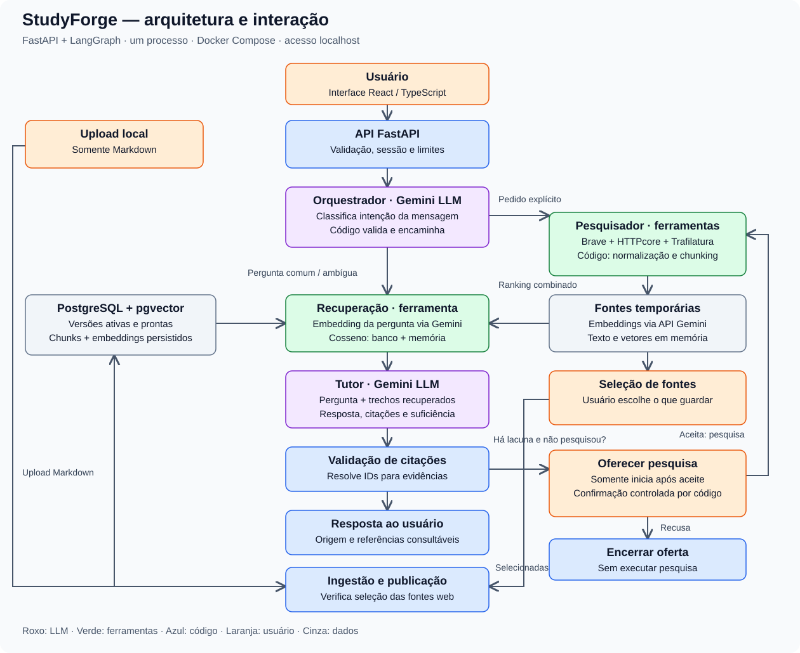

# StudyForge

**Um assistente pessoal de estudos que ensina com seus materiais e fontes da web, mantendo as referências ao alcance do usuário.**

Envie Markdown para a biblioteca e converse com um tutor que usa recuperação de conhecimento (RAG). Quando as evidências forem incompletas, ele explica a lacuna e oferece pesquisa. Páginas encontradas podem ser usadas temporariamente; guardar uma fonte exige sua seleção explícita.

MVP para uso pessoal em **localhost**, construído como monólito modular em contêineres. A arquitetura separa interpretação por LLM, ferramentas e operações determinísticas.

## O que você pode fazer

- **Biblioteca:** enviar Markdown e acompanhar processamento, disponibilidade e falhas.
- **Chat:** receber explicações com citações consultáveis e identificação de origem.
- **Pesquisa:** pedir uma busca na web ou aceitar a oferta após uma resposta parcial ou insuficiente.
- **Fontes:** inspecionar resultados HTML e selecionar quais deseja guardar.
- **Progresso:** acompanhar estados de pesquisas e ingestões.

## Arquitetura e interação entre agentes e nós

O diagrama mostra o modo real: roxo indica LLM, verde indica ferramentas, azul indica código de controle e laranja indica decisões do usuário.



[Fonte editável do diagrama em Mermaid](docs/diagrams/arquitetura.mmd).

**Dois papéis usam o LLM:** o orquestrador classifica intenção e o tutor gera a explicação. O pesquisador executa ferramentas. O código controla capacidades e orçamento; os agentes não autorizam gravação na biblioteca.

O classificador recebe somente a mensagem atual. Ambiguidade segue para recuperação; falha ou timeout usa a regra textual anterior como fallback. Pesquisa já solicitada pela ação da interface ou confirmada pelo usuário dispensa nova classificação. A classificação pode errar e continua sendo avaliada.

Após a pesquisa, os trechos temporários voltam para a recuperação antes de chegar ao tutor. A biblioteca é consultada com pgvector; fontes temporárias são comparadas em memória. O ranking combinado fornece até **cinco trechos**, na configuração padrão. A busca atual é exata, sem índice vetorial aproximado.

Resolver uma citação garante que seu identificador corresponde a uma evidência disponível. Verificar se ela sustenta a afirmação exige avaliação adicional de conteúdo.

## Stack

| Camada | Tecnologias |
|---|---|
| Interface | React, TypeScript, Vite e CSS puro |
| API e contratos | Python, FastAPI e Pydantic |
| Orquestração e documentos | LangGraph e LangChain |
| Geração e embeddings | Gemini via API, com modelos configuráveis |
| Pesquisa e extração | Brave Search, HTTPcore e Trafilatura |
| Persistência | PostgreSQL, pgvector, SQLAlchemy e Alembic |
| Ambiente e testes | Docker Compose, pytest e testes nativos do Node |
| Observabilidade opcional | LangSmith com spans explícitos |

Modelos, chunking e parâmetros de recuperação são experimentais. O [plano](specs/001-studyforge-mvp/plan.md) registra decisões e limitações.

## Executar localmente

Requer Docker com Compose e um navegador. Dependências, builds, migrações e testes rodam em contêineres.

Em um checkout novo, crie a configuração:

```powershell
Copy-Item .env.example .env
```

O exemplo começa em `APP_MODE=fixture`, sem credenciais externas: respostas, vetores e páginas sintéticas demonstram o fluxo. Esse modo não mede qualidade semântica.

```powershell
docker compose build app
docker compose up -d db
docker compose run --rm --no-deps -e DATABASE_URL=postgresql+psycopg://studyforge:studyforge-local@db:5432/studyforge app alembic upgrade head
docker compose up -d app
```

Abra **[http://127.0.0.1:8000](http://127.0.0.1:8000)**. A API também serve a interface compilada. A porta do PostgreSQL não é publicada no host. As credenciais de banco acima são exclusivas do laboratório local; a migração usa o papel administrativo e o serviço usa um papel restrito.

Para o modo real, configure no `.env`:

```dotenv
APP_MODE=real
GEMINI_API_KEY=sua_chave
SEARCH_API_KEY=sua_chave_brave
```

Aplique com `docker compose up -d app`. Chaves ficam no backend; não as coloque em variáveis `VITE_*` ou no Git. O [quickstart](specs/001-studyforge-mvp/quickstart.md) detalha permissões em volumes existentes, testes e integrações.

## Dados, memória e segurança

| Informação | Onde fica | Ciclo de vida |
|---|---|---|
| Materiais enviados e fontes web selecionadas | PostgreSQL | Persistem entre reinícios |
| Mensagens e fontes web não selecionadas | Memória do backend | Descartadas ao encerrar a conversa ou reiniciar |
| Estado de cada execução do grafo | Memória, sem checkpointer persistente | Limitado à execução |
| Traces, quando habilitados | LangSmith | Conforme a política do serviço externo |

O tutor recebe a pergunta atual e os trechos recuperados; o histórico completo não é enviado automaticamente. Perguntas dependentes de referências à conversa anterior ainda têm essa limitação.

Arquivos e páginas são dados sem autoridade para alterar permissões. A aplicação verifica a seleção de fontes fora do modelo, aplica limites de execução e protege a coleta contra destinos internos. Somente versões ativas e prontas entram na recuperação da biblioteca.

O modo real envia perguntas e trechos necessários ao Gemini, consultas ao Brave e acessa páginas públicas. A garantia de descarte é local; os provedores aplicam suas políticas. O tracing é opcional e desativado por padrão. Captura detalhada exige configuração separada e envia conteúdo ao LangSmith; veja o [guia de observabilidade](docs/observabilidade-langsmith.md).

## Testes e avaliações

Com o banco iniciado e a imagem construída:

```powershell
docker compose run --rm --no-deps -e TEST_DATABASE_URL=postgresql+psycopg://studyforge:studyforge-local@db:5432/studyforge app pytest -q -p no:cacheprovider
```

Testes de integração usam schemas isolados. Chamadas externas são opt-in e podem consumir cota.

- **Recuperação:** compara documentos e passagens esperadas com os resultados, usando Recall@k, MRR e cobertura de evidências.
- **Comportamento:** verifica consentimento, papéis, citações, ausência de evidência, falhas e descarte. Avaliações reais de conteúdo usam conjuntos pequenos e revisão humana; não há LLM juiz.
- **Regressão:** a [revisão de 31/10/2026](docs/revisao-progressiva.md) registra build, 154 testes backend e seis testes do cliente aprovados em exportação limpa do Git. Dois testes externos ficaram fora daquela rodada.

O corpus longo contém 12 artigos públicos e 32 perguntas. O baseline registrado teve **98,21% de Recall@5 de documentos e 92,86% de passage recall@5**, com rótulos não exaustivos. São métricas de recuperação naquele corpus. Veja [método e resultados](specs/001-studyforge-mvp/evidence/E3-web-corpus.md).

## Navegar pelo projeto

```text
backend/app/         API, agentes, recuperação, ingestão e observabilidade
backend/migrations/  Esquema e evolução do banco
backend/tests/       Testes unitários, contratos e integração
backend/evals/       Corpus, avaliações e experimentos isolados
frontend/src/        Interface, navegação e cliente da API
docs/                Guias e registros de revisão
specs/001-studyforge-mvp/  Especificação, plano, contratos e evidências
```

Comece pelo [guia didático](docs/guia-do-projeto.md) para acompanhar os fluxos e encontrar o código. O [estado da entrega](specs/001-studyforge-mvp/evidence/readiness.md) e as [tarefas](specs/001-studyforge-mvp/tasks.md) preservam as pendências: o MVP não é declarado integralmente validado. Avaliação pedagógica, PDF/OCR e integrações extensas permanecem fora desta entrega.
