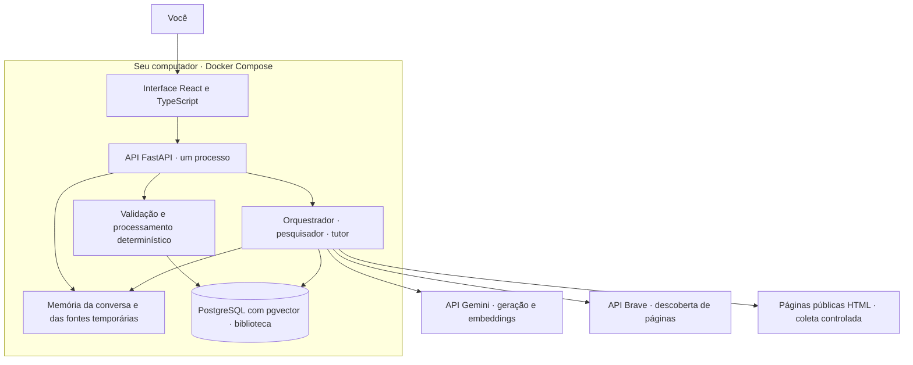
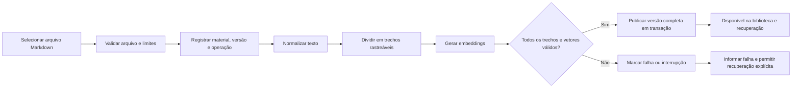
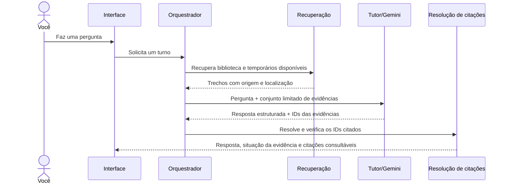
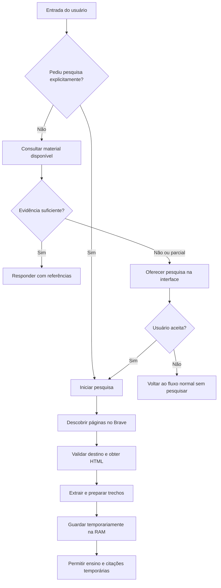
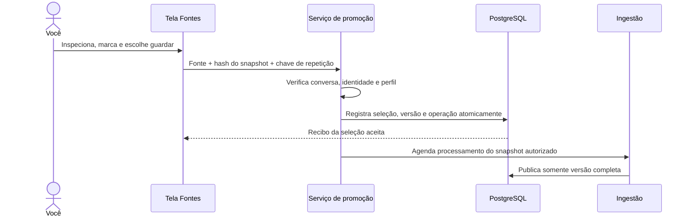
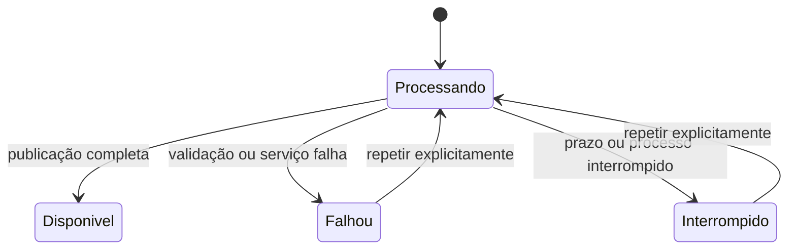

# StudyForge por dentro

Um guia para entender a estrutura, acompanhar os dados e encontrar o código.

**Referência:** implementação disponível em 29/10/2026. Este documento explica o
estado atual; a constituição define os princípios e a especificação define o
comportamento esperado. Decisões experimentais e validações pendentes continuam
identificadas nos relatórios do projeto.

## 1. A ideia central

Imagine uma mesa de estudos com três espaços:

- **Biblioteca:** materiais que você decidiu guardar. Continuam disponíveis depois
  de reiniciar a aplicação.
- **Mesa de trabalho:** conversa e fontes de pesquisa que você está usando agora.
  Ficam na memória e são descartadas ao encerrar a conversa ou reiniciar.
- **Tutor:** consulta os materiais disponíveis e explica o conteúdo com referências.
  Se as fontes não sustentam uma resposta, deve reconhecer a limitação.

Pesquisar uma página coloca a fonte na mesa de trabalho. **Somente a sua seleção
explícita permite levá-la para a biblioteca.** Uma resposta do tutor não concede
essa autorização.

## 2. O desenho geral



O frontend e a API pertencem à mesma aplicação. No modo de execução principal,
o FastAPI também entrega os arquivos compilados da interface. O PostgreSQL é o
único banco. Não há uma aplicação separada para cada agente, nem fila distribuída.

O acesso fica em `http://127.0.0.1:8000`. A porta do banco não é publicada no host.
O serviço opcional `web-dev` oferece Vite em localhost durante desenvolvimento.

**Local não significa offline:** no modo real, perguntas e trechos necessários
podem ser enviados ao Gemini, consultas de busca vão ao Brave e o backend visita
páginas públicas. O descarte garantido pelo StudyForge vale para seu armazenamento
local; os serviços externos aplicam as próprias políticas.

## 3. Onde encontrar cada parte

```text
study-forge/
├── .specify/memory/constitution.md   Princípios permanentes e regras de qualidade
├── specs/001-studyforge-mvp/
│   ├── spec.md                      Jornadas e critérios de aceite
│   ├── plan.md                      Desenho técnico e estratégia de entrega
│   ├── research.md                  Experimentos e decisões técnicas
│   ├── data-model.md                Entidades e regras de armazenamento
│   ├── contracts/openapi.json       Contrato HTTP de referência
│   ├── tasks.md                     Tarefas e andamento
│   └── evidence/                    Resultados observados, capturas e limitações
├── docs/                            Explicações para leitura e revisão
├── compose.yaml                     Serviços, isolamento e ambiente
├── backend/
│   ├── app/
│   │   ├── main.py                  Montagem da aplicação e ciclo de vida
│   │   ├── settings.py              Configuração e limites
│   │   ├── schemas.py               Entradas e saídas validadas com Pydantic
│   │   ├── security.py              Acesso local, sessão, CSRF e limite de corpo
│   │   ├── sessions.py              Conversas e descarte em memória
│   │   ├── operations.py            Orçamento de execução e tarefas limitadas
│   │   ├── api/                     Rotas HTTP
│   │   ├── agents/                  Supervisão, pesquisa, grafo e ensino
│   │   ├── providers/               Integrações Gemini e Brave
│   │   ├── ingestion/               Entrada, transformação e publicação
│   │   ├── db/                      Modelos SQLAlchemy e sessões de banco
│   │   ├── retrieval.py             Recuperação dos trechos relevantes
│   │   ├── citations.py             Resolução das referências
│   │   └── web_fetch.py             Coleta HTML com controles de destino
│   ├── migrations/                  Evolução do esquema com Alembic
│   ├── tests/                       Testes unitários, contratos e integração
│   └── evals/                       Corpus e avaliações separadas do produto
└── frontend/
    ├── src/pages/                   Biblioteca, chat, fontes e progresso
    ├── src/components/              Citações, detalhes, estados e Markdown seguro
    ├── src/api.ts                   Cliente HTTP e ciclo de sessão
    ├── src/types.ts                 Tipos dos contratos usados pela interface
    ├── src/App.tsx                  Navegação e estado geral
    ├── src/styles.css               Aparência em CSS puro
    └── tests/                       Regressões do cliente HTTP
```

Os documentos de planejamento têm trechos históricos. Para saber o que foi
**efetivamente executado**, comece por `evidence/readiness.md` e siga os relatórios
citados. Uma proposta no plano não é prova de implementação ou teste aprovado.

## 4. Fluxo A: enviar um Markdown



O recebimento do arquivo não significa que ele já pode fundamentar respostas.
A API devolve um recibo e a interface acompanha a operação. O texto autorizado
pode estar registrado enquanto a versão ainda está em processamento, mas seus
trechos só entram na recuperação depois da publicação completa.

**Normalizar** significa uniformizar aspectos como Unicode e quebras de linha,
preservando um mapa para localizar o trecho no texto original. **Chunking** é a
divisão do material em trechos contíguos, considerando sua estrutura Markdown.
O modelo não escolhe livremente os cortes nem grava o resultado no banco.

**Embedding** é uma representação numérica do texto, usada para comparar sua
proximidade com uma pergunta. Ele ajuda a encontrar conteúdo relacionado; não
comprova que uma afirmação é verdadeira ou que uma resposta está completa.

Arquivo principal: `backend/app/ingestion/service.py`. As transformações ficam
em `validate.py`, `normalize.py` e `chunk.py`, no mesmo diretório.

## 5. Fluxo B: perguntar ao tutor

O tutor usa **RAG**: primeiro recupera evidências, depois gera uma resposta apoiada
nessas evidências. É como localizar as páginas relevantes antes de explicar um tema.



A busca persistida considera apenas versões ativas publicadas e um perfil de
embeddings compatível. Os trechos temporários são comparados na RAM e combinados
com os resultados da biblioteca. A implementação atual faz ordenação por distância
de cosseno; não há um índice aproximado sofisticado exigido para este MVP.

O tutor recebe identificadores como `e1` e `e2`. A aplicação transforma esses IDs
em referências reais: trecho, material ou fonte, versão e localização. Um ID
inventado é rejeitado. O modelo não fornece um endereço arbitrário para criar uma
citação nem escolhe o texto de uma citação como se fosse prova independente.

Essa validação garante a identidade da referência. A avaliação de sustentação
ainda precisa verificar se o trecho realmente apoia o que foi dito.

Os estados de evidência distinguem suporte, suporte parcial, insuficiência e
conflito. Quando a base é insuficiente, a interface pode oferecer pesquisa.

**Limite atual da conversa:** mensagens e respostas ficam visíveis na sessão, mas
o tutor recebe a pergunta atual e os trechos recuperados; o histórico completo
não é enviado automaticamente como memória contextual. Melhorias de continuidade
da conversa continuam fora dessa implementação inicial.

## 6. Fluxo C: pesquisar sem guardar automaticamente



Resultados do buscador são candidatos. O corpo da página precisa ser obtido e
extraído antes de ser usado como evidência. Uma fonte que falha não deve aparecer
como conteúdo consultado com sucesso. Se apenas parte funciona, a pesquisa indica
falha parcial e mantém utilizáveis as fontes disponíveis.

O coletor valida endereços e DNS, rejeita destinos internos e fixa o IP público
validado na conexão. Isso reduz o risco de uma página tentar alcançar serviços
internos do computador ou da rede. Conteúdo externo continua sendo dado sem
autoridade: instruções escondidas na página não podem conceder permissões.

## 7. Fluxo D: promover uma fonte para a biblioteca



O **snapshot** é uma captura do texto extraído naquele momento. A promoção usa
essa captura exata, sem visitar novamente a página e trocar silenciosamente o
conteúdo que você inspecionou.

O hash identifica o conteúdo; a chave de idempotência ajuda a reconhecer uma
repetição da mesma ação. Constraints e transações no banco evitam duplicação
mesmo diante de dois cliques ou pedidos concorrentes.

Seleção aceita e ingestão concluída são momentos diferentes. Se a seleção foi
aceita antes de fechar a conversa, o processamento autorizado pode terminar.
Se a fonte já expirou ou seu conteúdo não corresponde ao inspecionado, a seleção
é recusada. Nenhum agente recebe uma ferramenta capaz de aprovar essa gravação.

Arquivo principal: `backend/app/ingestion/promotion.py`.

## 8. Os três papéis e seus limites

| Papel | Responsabilidade atual | Limite de autoridade |
|---|---|---|
| Orquestrador | Controlar o turno, consentimento, delegação e orçamento. | Não transforma decisão do modelo em autorização de persistência. |
| Pesquisador | Descobrir candidatos, obter HTML e preparar fontes temporárias. | Não grava automaticamente essas fontes na biblioteca. |
| Tutor | Explicar usando os trechos disponíveis e indicar evidências. | Não pesquisa nem seleciona/grava fontes por iniciativa própria. |

No código atual, esses são **papéis supervisionados**. O orquestrador usa Gemini
para classificar a intenção da mensagem atual; o tutor usa Gemini para formular
respostas com evidências. O pesquisador executa ferramentas e processamento
determinístico. O LangGraph organiza a sequência e os desvios autorizados.
Classificação ambígua segue para recuperação; falha do classificador usa a regra
textual anterior. A tela Fontes também oferece uma ação direta de pesquisa.

## 9. O que é guardado e por quanto tempo

| Informação | Onde fica | Ao encerrar ou reiniciar |
|---|---|---|
| Uploads Markdown e versões autorizadas | PostgreSQL | Permanecem. |
| Snapshots web selecionados e autorização | PostgreSQL | Permanecem. |
| Trechos, vetores e operações desses materiais | PostgreSQL | Permanecem; só versões completas entram no RAG. |
| Conversa, ofertas e citações do chat | RAM/estado da interface | São descartadas. |
| Fontes web não selecionadas e vetores temporários | RAM do backend | São descartados. |
| Cópias que os provedores eventualmente mantêm | Infraestrutura externa | Seguem as políticas dos provedores. |

Navegar entre telas preserva o que está temporário. Fechar a conversa descarta
esse contexto e abre um chat vazio. Não há restauração de chat pelo banco,
localStorage ou checkpoints do grafo.

O banco tem seis grupos principais: `materials`, `material_versions`, `chunks`,
`embedding_profiles`, `ingestion_operations` e `selection_grants`. Uma versão
preserva identidade, configuração do pipeline e origem; um chunk acrescenta a
localização do trecho. Alterar o pipeline ou perfil não deve reescrever silenciosamente
o significado de referências anteriores.

## 10. Como entender estados e falhas



O diagrama representa uma versão nova, inicialmente sem versão anterior disponível.
Se uma atualização falhar, uma versão antiga já publicada pode continuar ativa.

A tela **Progresso** mostra o trabalho operacional: ingestão, pesquisa, etapa e
tentativa. Não mede domínio, notas, conhecimento adquirido ou desempenho pedagógico.

`operations.py` limita tarefas admitidas e tempo/etapas/chamadas. Retentativas
externas são limitadas; não existe promessa de que um provedor sempre responderá.
Uma interrupção deixa estado recuperável, em vez de apresentar processamento
incompleto como sucesso. Diagnósticos usam campos permitidos e erros sanitizados,
sem guardar perguntas, documentos ou segredos como logs de depuração.

## 11. Como verificamos o projeto

| Verificação | Pergunta que responde |
|---|---|
| Testes unitários | Normalização, limites, citações e decisões locais seguem as regras? |
| Contratos HTTP | Entradas, saídas, erros e permissões correspondem ao contrato? |
| Integração com PostgreSQL | Publicação, concorrência, versões e recuperação funcionam no banco real? |
| Avaliação de retrieval | Os trechos recuperados contêm o material necessário para responder? |
| Avaliação dos agentes | A resposta reconhece lacunas, sustenta citações e respeita papéis? |
| Ensaio visual | A pessoa entende os estados e consegue navegar, selecionar e recuperar falhas? |

**Fixture** usa dados e respostas controlados, sem demonstrar qualidade do modelo
real. **Real** usa Gemini e Brave configurados no backend. Os resultados desses
modos são registrados separadamente. O corpus de avaliação é um conjunto público
selecionado para experimentos, separado da biblioteca pessoal e dos temporários
do produto. Seu cache autorizado não é um cache de conversas.

Builds, testes, avaliações e dependências são executados em contêineres. Para os
comandos disponíveis, consulte o [quickstart](../specs/001-studyforge-mvp/quickstart.md).

## 12. Um caminho de leitura do código

1. Abra `frontend/src/App.tsx` e observe os quatro destinos.
2. Siga uma chamada em `frontend/src/api.ts` até sua rota em `backend/app/api/`.
3. Para um upload, acompanhe `ingestion/service.py` e as funções textuais.
4. Para uma pergunta, acompanhe `agents/orchestrator.py`, `agents/graph.py`,
   `retrieval.py`, `agents/tutor.py` e `citations.py`.
5. Para pesquisa, leia `agents/researcher.py`, `providers/search.py` e `web_fetch.py`.
6. Para guardar uma fonte, leia `ingestion/promotion.py` e `db/models.py`.
7. Compare o fluxo com seus testes e com a evidência registrada.

Os parâmetros de chunking, top-k, dimensões e modelos são escolhas experimentais.
Este guia não converte resultados iniciais em metas aprovadas. A implementação
atual também não inclui avaliador pedagógico, PDF/OCR, quizzes, repetição espaçada,
gamificação, calendário ou múltiplos usuários.

**Para acompanhar as pendências reais:**
[estado da entrega](../specs/001-studyforge-mvp/evidence/readiness.md) ·
[tarefas](../specs/001-studyforge-mvp/tasks.md) ·
[ensaio visual](../specs/001-studyforge-mvp/evidence/rehearsal.md).

### Atualização de intenção — 30/10/2026

O orquestrador passou a usar Gemini para classificar a intenção da mensagem atual
antes da execução do grafo. Não recebe os materiais nem o histórico nessa etapa.
Pedido explícito reconhecido vai para pesquisa; pergunta comum ou ambígua vai
para recuperação. Aceite já confirmado não exige nova classificação. Falha do
modelo usa a regra textual anterior. O tutor continua responsável pela resposta.
