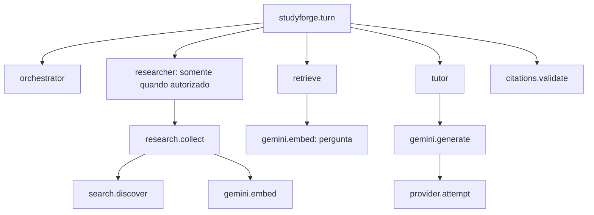

# Observabilidade do StudyForge com LangSmith

## O que está instrumentado

Cada turno gera uma árvore `studyforge.turn`. Os filhos mostram decisões e trabalho das etapas:

O trace é a árvore completa; cada etapa dentro dela é um span (também chamado run no painel).



Este desenho ilustra relações possíveis. Uma execução sem evidência pode não chamar Gemini;
uma execução sem autorização não passa pelo pesquisador. A árvore real é a fonte de diagnóstico.

Há dois modos. O padrão registra **metadados operacionais**, com entradas vazias.
Com `STUDYFORGE_TRACE_CONTENT=true`, o modo **detalhado** envia perguntas, passagens recuperadas,
prompts, respostas, fontes e referências ao LangSmith. O conteúdo fica armazenado no serviço,
sob sua política de retenção; encerrar a conversa descarta somente as cópias locais.
Um UUID de turno permite correlacionar a resposta local com a execução remota.
Contagens de tokens retornadas pelo Gemini aparecem nos outputs de `gemini.generate`;
custos não são calculados e não se promete preenchimento automático dos painéis nativos de uso.

## Configuração e acesso

No `.env` local, mantenha a chave fora do Git e configure:

```dotenv
STUDYFORGE_TRACING=true
STUDYFORGE_TRACE_CONTENT=true
LANGSMITH_API_KEY=sua-chave-local
LANGSMITH_PROJECT=studyforge-demo
LANGSMITH_ENDPOINT=https://api.smith.langchain.com
LANGSMITH_WORKSPACE_ID=
LANGSMITH_TRACING=false
LANGCHAIN_TRACING_V2=false
```

As duas últimas flags ficam falsas: desativam a instrumentação automática, que poderia
serializar o estado completo do grafo. O controle da nossa integração é `STUDYFORGE_TRACING`.
Para voltar a metadados, use `STUDYFORGE_TRACE_CONTENT=false` e recrie o container.
Essa mudança só afeta novas execuções: não completa traces antigos nem remove conteúdo já enviado.
Para conta europeia, use `https://eu.api.smith.langchain.com`. Chaves de múltiplos workspaces
podem exigir o UUID em `LANGSMITH_WORKSPACE_ID`.

Após alterar configuração:

```powershell
docker compose up -d --build app
```

O reinício descarta a conversa e as fontes temporárias atuais, conforme o ciclo de vida do produto.
Abra [LangSmith](https://smith.langchain.com), escolha o workspace e procure o projeto
`studyforge-demo` na área de tracing/observabilidade. Os nomes da navegação podem variar.
Em workspaces organizados por agentes, use em `LANGSMITH_PROJECT` o `tracer_session_name`
do ambiente do agente criado no painel. Esse é o identificador de compatibilidade suportado pelo SDK.

Abra uma linha `studyforge.turn` e expanda a árvore. Compare os horários e durações;
selecione um filho para consultar `Outputs`. No root, `Metadata` contém `turn_id`,
`app_mode` e `capture`. A tag `fixture` distingue ensaio de execução real.

## Teste manual na interface com conteúdo real

1. Abra o StudyForge e confira o aviso de observabilidade detalhada na interface.
2. Pergunte sobre um material disponível na biblioteca e espere a resposta terminar.
3. No LangSmith, abra a árvore mais recente com `capture=content` e `app_mode=real`.
4. Em `studyforge.turn`, veja `Inputs.question` e `Outputs.answer`.
5. Em `retrieve`, veja `Inputs.query` e `Outputs.documents`: texto, título, origem,
   localizador, ID de evidência e distância de cosseno. Distância não é confiança da resposta.
6. Em `tutor`, compare a pergunta e as evidências com `answer_markdown`, `citation_ids`,
   `evidence_status` e `unsupported_points` da saída estruturada.
7. Em `gemini.generate`, veja `Inputs.messages` (prompt efetivamente enviado) e
   `Outputs.generations` (texto bruto retornado), além dos contadores de tokens disponíveis.
8. Em `citations.validate`, compare os IDs propostos com as citações resolvidas para a interface.

`provider.attempt` continua mostrando tentativa e duração, sem serializar callbacks ou objetos
internos. Se não havia evidências, o tutor pode responder insuficiência sem chamar Gemini;
nesse caso, não haverá span de geração. Isso é comportamento real, não falha do tracing.
Pesquisa explícita também mostra consulta e resumos das fontes em `search.discover` e
`research.collect`. Embeddings de documentos capturam só uma amostra textual por chamada;
os vetores não são exportados.

As chaves configuradas no backend são mascaradas nas strings e campos de credencial são
removidos da captura. Isso não é anonimização geral de dados pessoais: use materiais cujo
envio ao serviço você autoriza. Nunca são serializados settings, orçamento, callbacks ou headers.
Há limites de 32 KiB por string e orçamento de 256 KiB de conteúdo textual por árvore,
além de limites de profundidade e itens. Cortes aparecem como `[TRUNCATED]` e em
`extra.metadata.content_truncated`. O modo detalhado também não grava spool local.

## Como interpretar uma execução

| Campo ou etapa | Interpretação prática |
|---|---|
| `orchestrator.research_authorized` | A aplicação autorizou ou não entrar no caminho de pesquisa. |
| `retrieve.count` | Quantos trechos chegaram ao conjunto de evidências. Zero indica ausência de candidatos disponíveis. |
| `library_count` / `temporary_count` | Origem dos candidatos; uso temporário não significa ingestão. |
| `tutor.evidence_status` | Classificação de suporte dada pelo tutor; exige avaliação para comprovar correção. |
| `citations.validate` | IDs pertencem ao conjunto disponível e foram resolvidos pela aplicação. Não comprova sozinho sustentação semântica. |
| `provider.attempt` | Tentativas reais, inclusive eventual segunda tentativa; são parte do tempo da chamada externa. |
| root `status` | Resultado de produto: por exemplo `complete`, `partial`, `awaiting_research_consent` ou `failed`. |
| `error` / `error_code` | Código sanitizado; indica onde começar a investigação sem expor a exceção original. |

**Execução tecnicamente bem-sucedida pode terminar com evidência insuficiente.** Isso é uma
resposta válida do sistema. Um trace verde não demonstra que a resposta está correta.

Se a resposta ficou ruim, investigue nesta ordem:

1. O pesquisador foi acionado com autorização? A recusa deve produzir zero pesquisa.
2. Houve recuperação? Quantos candidatos e de quais origens?
3. O tutor reconheceu insuficiência ou gerou uma resposta com citações?
4. A validação das referências passou? Em seguida, confira o conteúdo pela interface do StudyForge.
5. Se houve falha, encontre a primeira etapa com erro. Se houve demora, identifique a etapa mais longa.

Tempos de pais incluem os filhos: não some todas as durações da árvore. Campos de decisão são
o comportamento observável do sistema; não representam acesso ao raciocínio interno do modelo.

## Ensaio pronto para a apresentação

Para popular o painel com cenários determinísticos, sem chamar Gemini, Brave ou a biblioteca:

```powershell
docker compose run --rm --no-deps -e APP_MODE=fixture app python -m evals.trace_demo
```

O comando executa o orquestrador e o grafo reais com entradas e recuperação de fixture.
Produz cinco árvores: recuperação com referência, insuficiência, recusa de pesquisa,
falha simulada da recuperação e pesquisa explicitamente autorizada com fontes temporárias.
O tutor de fixture é extrativo e classifica respostas como parciais; por isso mesmo a primeira
execução pode terminar em `awaiting_research_consent`. Isso é esperado, não é um teste de qualidade de LLM.
A falha simulada deve aparecer no root e em `retrieve`; não deve executar o tutor.

Para ensaiar sem acesso ao LangSmith:

```powershell
docker compose run --rm --no-deps app python -m evals.trace_demo --offline
```

Para mostrar tráfego real, use o chat do StudyForge com `APP_MODE=real` e material público
autorizado na biblioteca. Faça uma pergunta respondível, outra sem suporte e recuse a busca;
depois peça explicitamente uma pesquisa web. As cotas do Gemini/Brave continuam independentes.
Não apresente as fixtures como validação dessas integrações.

Roteiro de aproximadamente três minutos:

1. **Contexto:** “Uso observabilidade para verificar execução, decisões e falhas do harness.”
2. **Fluxo:** abra uma árvore e mostre supervisão, recuperação, tutor e referências.
3. **Controle:** mostre insuficiência e recusa; compare com o caminho de pesquisa autorizada.
4. **Diagnóstico:** abra a falha simulada e explique por que o tutor não executou.
5. **Qualidade:** apresente a comparação de embeddings: o trace localiza etapas; o corpus rotulado
   mede se a recuperação encontrou evidências. São verificações complementares.
6. **Limites:** explique o modo de captura escolhido, o armazenamento remoto e que indisponibilidade do tracing não bloqueia o produto.

## Se o painel estiver vazio

No navegador com o StudyForge aberto e sessão iniciada, consulte:

```javascript
await fetch('/api/observability').then(r => r.json())
```

`sent` conta árvores enviadas sem erro HTTP; `failed` conta exportações com erro;
`dropped` conta descartes por fila cheia ou desligamento; `queued` mostra a fila atual.
`last_error_code` distingue `EXPORT_RATE_LIMITED`, `EXPORT_AUTH_FAILED`, `EXPORT_TIMEOUT`
e `EXPORT_FAILED`, sem revelar exceções ou credenciais. Uma exportação bem-sucedida limpa esse código.
Esses contadores reiniciam com o processo e não comprovam indexação no painel.
Se `enabled=false`, recrie o container com a configuração ativa. Se `failed` aumentar,
confira chave, região, workspace, nome de destino e limites no painel. Não imprima o `.env`.

O envio usa fila em RAM de até oito árvores, até 64 spans por árvore e dez segundos por
exportação, sem retentativa de transporte nem gravação em disco. Uma falha no meio pode
deixar árvore remota incompleta; o desligamento pode perder os últimos traces. Essa escolha
evita transformar observabilidade em dependência da resposta ao usuário.

## Evidência desta integração

O ensaio inicial de metadados aceitou cinco árvores, sem falhas ou descartes. A consulta posterior à API
confirmou que as cinco árvores foram indexadas com entradas vazias.
Não foi feita revisão visual do painel nesta integração. As verificações determinísticas
cobrem hierarquia, isolamento de turnos, campos permitidos, recusa, fontes temporárias, falha
controlada e indisponibilidade do exportador. Resultados finais em
`specs/001-studyforge-mvp/evidence/langsmith.md`.

Atualização de 30/10/2026: modo detalhado validado com cinco árvores de fixture e uma jornada
HTTP real Markdown → embeddings → recuperação → Gemini → citações em schema isolado.
A leitura posterior confirmou seis roots com conteúdo e, na árvore real, pergunta, resposta,
passagens e prompt/resposta bruta. Suíte: 142 aprovados, dois externos opt-in skipped;
jornada Gemini real executada separadamente: um teste aprovado. Evidência em
`specs/001-studyforge-mvp/evidence/langsmith-content.md`.

Referências: [configuração programática](https://docs.langchain.com/langsmith/trace-without-env-vars)
e [compatibilidade entre projetos e ambientes de agentes](https://docs.langchain.com/langsmith/log-traces-to-agent).
