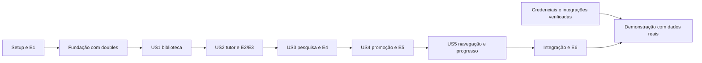

# Tasks: StudyForge — assistente pessoal de estudos (MVP)

## Incremento autorizado: observabilidade para apresentação

### Captura detalhada autorizada em 2026-10-30

- [X] T101 Adicionar modo opt-in de conteúdo com limites, mascaramento e fallback de metadados — settings, observability, Compose.
- [X] T102 Capturar pergunta, evidências, prompt, resposta e citações nas fronteiras explícitas — agentes/providers.
- [X] T103 Atualizar divulgação externa, status sanitizado, OpenAPI e testes de privacidade/limites/modos.
- [X] T104 Validar suíte, fixtures detalhadas, jornada HTTP Gemini real isolada e leitura dos registros remotos — `evidence/langsmith-content.md`.
- [X] T105 Habilitar configuração local e atualizar guia de teste manual e preparação da entrevista.

T101–T105 acrescentam cinco tarefas ao incremento anterior, sem fechar pendências do MVP.

As quatro pendências antigas do checklist permanecem abertas; autorização anterior para
prosseguir preservada. Este incremento não encerra checkpoints pendentes do MVP.

- [X] T095 Definir captura mínima e configuração opcional LangSmith, preservando retenção local,
  credenciais no backend e bloqueio de captura automática — `plan.md`, `.env.example`, `compose.yaml`.
- [X] T096 Implementar árvores por turno e spans de agentes, recuperação, chamadas/tentativas e
  citações, com erros sanitizados e exportação RAM limitada — `backend/app/observability.py`, agentes/providers.
- [X] T097 Expor status protegido e divulgação externa, atualizar contrato e testar privacidade,
  hierarquia, isolamento, fila e falha de exportação — runtime, OpenAPI, `test_observability.py`.
- [X] T098 Criar ensaio do grafo real com fixtures, recusa, pesquisa e falha controlada — `backend/evals/trace_demo.py`.
- [X] T099 Executar suíte, build, ensaio remoto e consulta de indexação; habilitar configuração
  local com a chave fornecida sem exibi-la — `evidence/langsmith.md`.
- [X] T100 Documentar painel, interpretação, investigação, limites e roteiro — `docs/observabilidade-langsmith.md`.

Evidência: **136 passed, 2 externos opt-in skipped; cinco árvores indexadas; readiness 200**.
Não comprova ensaio visual do painel. A contagem original de 94 tarefas abaixo é histórica;
o incremento acrescenta seis tarefas, totalizando 100.

**Feature**: `001-studyforge-mvp`

**Created**: 2026-10-28

**Input**: [spec.md](spec.md), [plan.md](plan.md), [research.md](research.md),
[data-model.md](data-model.md), [HTTP/UI](contracts/api.md), [OpenAPI](contracts/openapi.json),
[agentes](contracts/agents.md) e [quickstart.md](quickstart.md).

**Status**: implementação em andamento. Ambiente/fundação e biblioteca implementados; fluxos locais das cinco histórias com fixtures e testes integrados. As verificações permanecem abertas quando a evidência completa exigida não existe. G0 externo retirado pelo usuário em 2026-10-29; integrações reais ainda exigem configuração e testes. Consulte [readiness](evidence/readiness.md).

**Tests**: testes relevantes e avaliações são exigidos por FR-025 e pela constituição. Sua ordem
na lista organiza trabalho e dependências; não impõe TDD nem cobertura arbitrária.
Instalar, construir, testar e avaliar somente em contêineres. Host apenas para Git, edição e Docker.

**Organization**: oito fases, cinco histórias. O primeiro incremento é US1 (upload/biblioteca);
o MVP confirmado inclui US1–US5. Não reduzir a entrega a US1 nem acrescentar avaliador pedagógico,
PDF/OCR, quizzes, calendário, multiusuário, filas distribuídas ou banco adicional.

## Format: `[ID] [P?] [Story] Description`

- IDs T001–T094 são sequenciais; `[US1]` a `[US5]` identificam histórias.
- `[P]` indica trabalho em arquivos distintos, com pré-requisitos já completos. Não autoriza
  executar fase futura, ignorar controles locais ou usar agentes adicionais automaticamente.
- `dep.` lista dependências diretas. Além delas, respeitar as barreiras das fases e o grafo abaixo.
- Tarefas de adicionar testes entregam casos e asserções executáveis e revisados; não exigem
  teste vermelho antes da implementação. Executar e registrar aprovação é obrigação do checkpoint
  ou da tarefa de verificação após os componentes existirem. Arquivo criado não significa teste aprovado.
- Testes externos exigem credenciais disponíveis e dados próprios/autorizados para aquele ensaio.
  Ausência de credencial/evidência é pendência declarada, não sucesso, bypass ou motivo de gravar fonte.

## Path Conventions

Os caminhos das tarefas são relativos à raiz do repositório: `backend/`, `frontend/`,
`compose.yaml` e `specs/001-studyforge-mvp/`. Arquivos ainda não existentes são entregáveis a criar.
`evidence/` guarda somente resultados sanitizados, configurações sem segredos e material de
teste próprio/autorizado; nunca snapshots, URLs, respostas ou markers de fontes reais não selecionadas.
Na execução, resolver esses caminhos contra a raiz e observar [AGENTS.md](../../AGENTS.md).

## Regras de execução e gates

1. **Retenção local (revisão 2026-10-29)**: G0 externo retirado pelo usuário. Verificar ausência de persistência local de conversas/fontes não selecionadas e informar envio às APIs. Provedores seguem suas próprias políticas; não exigir comprovante de retenção zero.
2. **E1**: locks de bootstrap são candidatos. T008/T009 comprovam o conjunto e consolidam versões/digests;
   geração e embedding continuam configuráveis e provisórios. Nenhuma sugestão numérica vira meta
   aprovada sem evidência e discussão.
3. **Fundação**: T023 deve passar antes de iniciar histórias. Não precisa de tráfego real:
   SDK, relógio e transporte podem ser doubles. E2 é executado na história de tutoria para não
   transformar credenciais externas em pré-requisito de criar a biblioteca com fixtures.
4. **Pesquisa**: pedido explícito inicia sem nova confirmação; falta considerável de material
   oferece busca e aguarda aceitação. Recusa ou espera executa zero pesquisa.
5. **Persistência**: seleção explícita do usuário, validada fora do grafo; nunca texto do modelo.
   Promover snapshot inspecionado sem refetch. Sem chat/checkpoints/traces duráveis.
6. **Descarte**: navegar preserva fontes; fechar conversa ou reiniciar descarta conteúdo temporário.
   Fechar descarta a conversa inteira e abre chat vazio, preservando a biblioteca.
7. **Demonstração**: checkpoints distinguem doubles, fixtures e fornecedor real. Falta de
   integração exigida impede declarar demonstração integral pronta, sem impedir trabalho seguro
   em código e fixtures. A reserva de integração/correção/ensaio da hipótese de 20 dias-pessoa
   permanece; esta lista não promete prazo novo.

## Phase 1: Setup — ambiente e experimentos iniciais

**Goal**: Preparar execução em contêiner, evidência de E0/E1 e contratos de trabalho sem criar serviços extras.

**Independent Test / Checkpoint**: Build e imports em contêiner com dados de fixture; configuração não permite tráfego real incompatível.

- [X] T001 Registrar regra E0 de retenção local e aviso de envio externo, incorporando o esclarecimento que retirou G0 — `specs/001-studyforge-mvp/evidence/E0-retention.md`, `specs/001-studyforge-mvp/research.md`.
- [X] T002 [P] Criar pacote Python/entrypoints e dependências candidatas, gerando lock candidato em contêiner de bootstrap para permitir o primeiro build; consolidar somente após E1 — `backend/pyproject.toml`, `backend/app/__init__.py`, `backend/requirements.lock`.
- [X] T003 [P] Criar shell mínimo buildável React/TypeScript strict, Vite e CSS puro com scripts typecheck/build e lock candidato em contêiner de bootstrap; sem framework CSS ou estado adicional — `frontend/package.json`, `frontend/tsconfig.json`, `frontend/vite.config.ts`, `frontend/src/main.tsx`, `frontend/package-lock.json`, `frontend/index.html`, `frontend/src/App.tsx`, `frontend/src/styles.css`.
- [X] T004 Definir configuração de exemplo, arquivos ignorados e build context sem segredos, relatórios de conteúdo real, caches e arquivos de ambiente — `.env.example`, `.gitignore`, `.dockerignore` (dep.: T001).
- [X] T005 Criar app+db em Compose, PostgreSQL sem porta publicada, app somente 127.0.0.1:8000, build Node/Python, perfil web-dev, tmpfs e ausência de volume de conteúdo no app — `compose.yaml`, `backend/Dockerfile`, `frontend/Dockerfile` (dep.: T002, T003, T004).
- [X] T006 Configurar pytest com markers unit/contract/integration/external, factories, relógio/SDK/HTTP doubles e schema PostgreSQL isolado sem apagar biblioteca — `backend/tests/conftest.py`, `backend/tests/fakes.py`, `backend/pyproject.toml` (dep.: T002, T005).
- [X] T007 Definir perfil experiment-v1 com limites finitos do plano, modelos/perfis configuráveis, flags de tracing recusadas no modo real e validação de segredos/backend — `backend/app/settings.py` (dep.: T004, T002).
- [X] T008 Executar E1 em contêiner: imports Python, typecheck e build Vite, conexão e vetor conhecido no PostgreSQL; corrigir incompatibilidades sem declarar o conjunto testado antes do resultado — `backend/tests/integration/test_environment.py`, `specs/001-studyforge-mvp/evidence/E1-runtime.md` (dep.: T005, T006, T007).
- [X] T009 Gerar locks com dependências transitivas e hashes, resolver digests das imagens e registrar versões efetivas após E1; não manter latest no perfil de demonstração — `backend/requirements.lock`, `frontend/package-lock.json`, `compose.yaml`, `specs/001-studyforge-mvp/research.md` (dep.: T008).

**Checkpoint**: E1 e locks conferidos; T001 pode registrar gate bloqueado, sem tratá-lo como aprovado. Não executar dados pessoais em serviços incompatíveis.

## Phase 2: Foundational — contratos, sessão e controles compartilhados

**Goal**: Criar a fundação do monólito; a retenção local é garantida sem gate externo de retenção zero.

**Independent Test / Checkpoint**: Contratos base, controles locais, budgets, descarte e configuração de provedor comprovados com doubles.

- [X] T010 Definir modelos Pydantic/enums e referências discriminadas a partir do OpenAPI, sem tornar selecionada uma fonte a partir de campo fornecido por modelo — `backend/app/schemas.py` (dep.: T009).
- [X] T011 Configurar engine AsyncSession por unidade de trabalho e Alembic, privilégios de setup/runtime e extensão pgvector no único PostgreSQL — `backend/app/db/session.py`, `backend/alembic.ini`, `backend/migrations/env.py` (dep.: T009).
- [X] T012 [P] Adicionar testes de Host/Origin, CSRF, cookie, bootstrap, multipart cross-site, CORS e proteção de chaves; cobrir as exceções de bootstrap do contrato — `backend/tests/contract/test_local_security.py` (dep.: T010, T006).
- [X] T013 [P] Adicionar testes de epoch, fechamento, IDs antigos, nova instância e callback atrasado, sem checkpoint/store e sem restauração de mensagens — `backend/tests/unit/test_sessions.py` (dep.: T010, T006).
- [X] T014 [P] Adicionar testes de deadline, tentativas totais, concorrência e admissão limitada; retry de SDK não pode multiplicar orçamento — `backend/tests/unit/test_execution_limits.py` (dep.: T007, T006).
- [X] T015 Implementar sessão/conversa somente em RAM, lock/epoch, invalidação, cancelamento e descarte integral; manter no máximo tombstones sem conteúdo na RAM — `backend/app/sessions.py` (dep.: T013, T010).
- [X] T016 Implementar executor limitado no mesmo processo, orçamento monotônico e estados explícitos; excesso recusa admissão sem fila ilimitada — `backend/app/operations.py` (dep.: T014, T007, T015).
- [X] T017 Criar FastAPI e guardas locais, envelopes sanitizados, no-store, bootstrap, runtime público e health sem chamadas externas; usar sessão e CSRF nas mutações — `backend/app/main.py`, `backend/app/api/sessions.py`, `backend/app/api/runtime.py`, `backend/app/security.py` (dep.: T010, T011, T012, T015).
- [X] T018 Implementar diagnóstico por allowlist e sanitização de exceções; desabilitar prompts/corpos, SQL parameters, traces e flags legadas de tracing no perfil real — `backend/app/diagnostics.py`, `backend/app/main.py` (dep.: T017, T007).
- [X] T019 Provar erro antes do envio com credenciais/configuração ausentes e ausência de payload/segredo em logs, caches e exceções; fixtures são controladas no servidor, não por opção livre do chat — `backend/tests/unit/test_provider_policy.py`, `backend/tests/integration/test_diagnostics_privacy.py` (dep.: T018, T006).
- [X] T020 Implementar fronteira Gemini para geração/embeddings, validação de credenciais/configuração, configuração de modelos, limite de tokens e retry controlado pela aplicação; sem Files/Search/cache/state remoto — `backend/app/providers/gemini.py` (dep.: T019, T016, T010).
- [X] T021 Criar cliente HTTP tipado com sessão/CSRF, polling terminal, limpeza por server_instance_id e erros; sem storage persistente, service worker ou replay automático de perguntas — `frontend/src/api.ts`, `frontend/src/types.ts` (dep.: T017, T010).
- [X] T022 Criar shell React e componentes StatusBadge/ErrorNotice/MarkdownView com CSS puro, HTML bruto e imagens remotas desabilitados e links seguros — `frontend/src/App.tsx`, `frontend/src/styles.css`, `frontend/src/components/StatusBadge.tsx`, `frontend/src/components/ErrorNotice.tsx`, `frontend/src/components/MarkdownView.tsx` (dep.: T021).
- [X] T023 Executar testes da fundação com doubles em contêiner, comprovando guardas locais, budgets, descarte, sanitização e retenção local antes de iniciar as histórias — `specs/001-studyforge-mvp/evidence/Foundation.md` (dep.: T022, T020, T018, T017, T015, T016).

**Checkpoint**: base compartilhada validada com doubles por T023; nenhuma conversa ou fonte não selecionada durável.

## Phase 3: User Story 1 — enviar materiais e acompanhar a biblioteca (P1)

**Goal**: Entregar upload Markdown, processamento determinístico, biblioteca consultável e falhas compreensíveis.

**Independent Test / Checkpoint**: Upload válido torna-se READY; inválido é rejeitado; falha nunca publica chunks parciais e não oculta materiais já disponíveis.

- [X] T024 [US1] Preparar Markdown próprio com títulos, listas, tabelas, fences longas, Unicode/CRLF/BOM e casos vazios/binários/inválidos, com snapshots e locators esperados — `backend/tests/fixtures/markdown/cases.json`, `backend/tests/fixtures/markdown/structure.md` (dep.: T022).
- [X] T025 [P] [US1] Adicionar golden tests de validação/normalização/chunking, preservação estrutural, hashes e correspondência text[start:end] por pontos de código, sem depender de LLM — `backend/tests/unit/test_text_pipeline.py` (dep.: T024).
- [X] T026 [P] [US1] Adicionar testes de contrato para upload/lista/detalhe/chunk e operação/retry, incluindo arquivo inválido, byte cap antes de spool, MIME/nome enganoso e estados — `backend/tests/contract/test_materials.py` (dep.: T024, T017).
- [X] T027 [P] [US1] Adicionar testes PostgreSQL de rollback, último embedding com falha, perfil/dimensão inválidos, recuperação queued/running órfã e proteção de versão ativa contra retry antigo — `backend/tests/integration/test_ingestion_publication.py` (dep.: T024, T011).
- [X] T028 [US1] Criar Material/MaterialVersion/Chunk/EmbeddingProfile/IngestionOperation e migração, chaves únicas/FKs, version_number sob lock e imutabilidade de READY — `backend/app/db/models.py`, `backend/migrations/versions/0001_library.py` (dep.: T026, T027, T011).
- [X] T029 [P] [US1] Implementar leitura limitada e validação Markdown UTF-8/NUL/conteúdo/extensão, tratando filename como metadado e nunca caminho — `backend/app/ingestion/validate.py` (dep.: T025).
- [X] T030 [P] [US1] Implementar snapshots, normalização NFC/LF/BOM com mapas de origem e parsing por blocos, preservando espaços semânticos, código e estrutura — `backend/app/ingestion/normalize.py` (dep.: T025).
- [X] T031 [US1] Implementar chunker com parâmetros experimentais, block boundaries, divisão de blocos grandes, locators e fingerprint determinísticos; não inserir texto sintético nas quotes — `backend/app/ingestion/chunk.py` (dep.: T029, T030).
- [X] T032 [US1] Implementar ingestão local autorizada, embeddings fora da transação, validação de conjunto completo, publicação atômica e versão ativa monotônica; preservar READY anterior se nova versão falhar — `backend/app/ingestion/service.py` (dep.: T028, T031, T020, T016).
- [X] T033 [US1] Integrar admissão/agendamento, falha após commit e boot recovery de queued/running órfãs, inclusive runner nulo; retry explícito/idempotente sem restaurar conversa — `backend/app/operations.py`, `backend/app/main.py` (dep.: T032).
- [X] T034 [US1] Implementar upload/lista/detalhe e consulta de chunk READY com associação dos IDs, operações e retry permitido; manter filtros de estado e erros sanitizados — `backend/app/api/materials.py`, `backend/app/api/operations.py`, `backend/app/main.py` (dep.: T032, T033).
- [X] T035 [US1] Implementar biblioteca vazia/upload/lista/detalhe, material disponível/processando/falhou/interrompido, origem/passagem e recuperação explícita, com renderização segura — `frontend/src/pages/Library.tsx`, `frontend/src/components/MaterialDetail.tsx`, `frontend/src/api.ts` (dep.: T034, T022).
- [ ] T036 [US1] Executar testes US1 e ensaio de biblioteca com fixtures em contêiner; confirmar nenhuma publicação parcial e registrar resultados/restrições reais — `specs/001-studyforge-mvp/evidence/US1-library.md`, `backend/tests/integration/test_library_journey.py` (dep.: T035).

**Checkpoint**: US1 demonstrável com seus estados/falhas e evidência registrada. Verificação com doubles não comprova integração externa; anotar o que falta.

## Phase 4: User Story 2 — aprender com o tutor e verificar referências (P1)

**Goal**: Entregar RAG da biblioteca e tutoria verificável, com supervisão, insuficiência e fechamento sem histórico durável.

**Independent Test / Checkpoint**: Biblioteca sem pesquisa: explicar caso sustentado, localizar passagem, reconhecer ausência/parcialidade/conflito e descartar conversa no fechamento/reinício.

- [X] T037 [US2] Executar E2 com cinco casos próprios/autorizados por candidato e repetição controlada; registrar esquema, latência, uso/custo e limites da evidência sem dados pessoais — `backend/tests/integration/test_gemini_external.py`, `specs/001-studyforge-mvp/evidence/E2-gemini.md`, `specs/001-studyforge-mvp/research.md` (dep.: T020).
- [X] T038 [US2] Preparar corpus de 12 documentos com origem/licença e perguntas rotuladas (ampliado pelo usuário para 32 perguntas e textos completos da web), com relevância/IDs/locators esperados e casos sem evidência, sem preencher metas ainda não aprovadas — `backend/evals/corpus/manifest.json`, `backend/evals/retrieval_cases.jsonl` (dep.: T036).
- [X] T039 [P] [US2] Adicionar testes de ranking por cosseno, filtro active READY, empate estável, perfil incompatível e perguntas sem suporte, usando vetores fixos e PostgreSQL real — `backend/tests/integration/test_retrieval_library.py` (dep.: T038).
- [ ] T040 [P] [US2] Adicionar testes de resposta/citações para suporte, lacuna, conflito, ID/quote inventados, instruções hostis e interrupção; schema válido não basta para sustentação — `backend/tests/unit/test_tutor_evidence.py` (dep.: T038).
- [X] T041 [P] [US2] Adicionar contratos de conversa/turno/citação e testes de fechar/reiniciar/callback tardio sem restauração, incluindo sessão inválida e operação concorrente — `backend/tests/contract/test_chat.py` (dep.: T038, T015).
- [X] T042 [US2] Implementar retrieval exato SQLAlchemy/pgvector somente para active READY/perfil compatível, com top-k experimental e filtro calibrável sem score universal de evidência — `backend/app/retrieval.py` (dep.: T039).
- [X] T043 [US2] Implementar evidence set e resolução determinística de IDs/quote/locator, categoria de origem e validação de passagem; rejeitar referências fora do conjunto disponível — `backend/app/citations.py` (dep.: T042, T040).
- [X] T044 [US2] Implementar tutor LangChain/Gemini com saída Pydantic, suporte parcial/conflitante/ausente, orçamento e no máximo correção de esquema permitida — `backend/app/agents/tutor.py` (dep.: T043, T020).
- [X] T045 [US2] Implementar nó orquestrador e grafo LangGraph sem checkpointer/store, delegando recuperação/tutor, classificando evidência e retornando oferta sem pesquisar antecipadamente — `backend/app/agents/orchestrator.py`, `backend/app/agents/graph.py` (dep.: T044, T015).
- [X] T046 [US2] Implementar criar/fechar conversa, turnos/polling e consulta de citações; invalidar epoch antes de cancelar e abrir novo chat no fluxo do cliente — `backend/app/api/chat.py`, `backend/app/api/citations.py`, `backend/app/main.py` (dep.: T045, T041).
- [X] T047 [US2] Implementar chat, espera/resposta parcial/insuficiência/erro, citações consultáveis da biblioteca e Encerrar conversa que limpa estado e abre chat vazio — `frontend/src/pages/Chat.tsx`, `frontend/src/components/Citation.tsx`, `frontend/src/api.ts` (dep.: T046, T022).
- [X] T048 [US2] Implementar runner retrieval com Recall@3/5/8, MRR e relevância por pergunta; separar ausência de evidência de recall e persistir apenas fixtures autorizadas — `backend/evals/run.py`, `backend/evals/retrieval.py` (dep.: T042, T038).
- [ ] T049 [US2] Executar E3 em contêiner com vetores conhecidos e embeddings reais autorizados, comparar chunking/dimensões/top-k e variação; registrar baseline e parâmetros mantidos/alterados — `specs/001-studyforge-mvp/evidence/E3-retrieval.md`, `specs/001-studyforge-mvp/research.md` (dep.: T048, T047, T037).
- [ ] T050 [US2] Executar US2-1 a US2-7 e verificar ausência de chat/checkpoints/traces em SQL, arquivos e logs, preservação da biblioteca e declaração de uso de doubles ou serviço real — `backend/tests/integration/test_tutor_journey.py`, `specs/001-studyforge-mvp/evidence/US2-tutor.md` (dep.: T049).

**Checkpoint**: US2 demonstrável com seus estados/falhas e evidência registrada. Verificação com doubles não comprova integração externa; anotar o que falta.

## Phase 5: User Story 3 — pesquisar e estudar com fontes temporárias (P2)

**Goal**: Entregar pesquisa supervisionada, consentimento correto, tutoria temporária e descarte sem persistência indireta.

**Independent Test / Checkpoint**: Usar HTML de fixture com disponível/indisponível/não extraível; verificar pedido explícito, oferta aceita/recusada/pendente, origens mistas e expiração.

- [X] T051 [US3] Preparar seis fixtures HTML próprias com artigo, documentação, código, lista/tabela, boilerplate e conteúdo quebrado/hostil; manter expected extraction/locators — `backend/tests/fixtures/html/cases.json`, `backend/tests/fixtures/html/structure.html` (dep.: T050).
- [X] T052 [P] [US3] Adicionar testes que observam destino efetivo de conexão: A/AAAA misto, privado/metadata/IPv4 mapeado, rebinding, redirects, fallback/retry, proxies e gzip expansivo — `backend/tests/unit/test_safe_fetcher.py` (dep.: T051).
- [X] T053 [P] [US3] Adicionar testes de extração repetível com estrutura/código/tabela e locator no snapshot, sem cache cross-documento nem chamada de rede pelo extrator — `backend/tests/unit/test_html_extraction.py` (dep.: T051).
- [X] T054 [P] [US3] Adicionar testes de papéis e consentimento: pedido explícito sem oferta extra, KB incompleta exige aceitação, recusa/espera zero chamadas, intenção ambígua e instrução de fonte sem autoridade — `backend/tests/unit/test_research_authorization.py` (dep.: T051).
- [X] T055 [P] [US3] Adicionar contratos de pesquisa/fonte/decisão, vazio/parcial/erro, fonte expirada e fechamento concorrente; não usar snippet como prova de corpo obtido — `backend/tests/contract/test_research.py` (dep.: T051).
- [X] T056 [US3] Implementar SafeFetcher com IP aprovado sem segunda resolução, Host/SNI/TLS corretos, redirects manuais e revalidação por tentativa, sem proxy/cookies e com limites descomprimidos — `backend/app/web_fetch.py` (dep.: T052).
- [X] T057 [P] [US3] Implementar descoberta mínima Brave com consulta sanitizada do usuário, timeouts/retries e falhas tipadas; uma única implementação de provedor, sem grounding integrado — `backend/app/providers/search.py` (dep.: T054, T020).
- [X] T058 [US3] Implementar Trafilatura extraction-only sobre bytes seguros, configuração/fingerprint fixos e ponte para normalização/chunking; rejeitar formato e conteúdo não extraível — `backend/app/ingestion/extract_html.py` (dep.: T056, T053, T031).
- [X] T059 [US3] Adicionar ResearchOffer/Run/TemporarySource/vetores/citações à RAM da conversa com epoch, quota e descarte integral; recusar excesso sem expirar fontes por navegação — `backend/app/sessions.py` (dep.: T055, T058).
- [X] T060 [US3] Implementar pesquisador restrito a descoberta/fetch/extração e integrar delegação no grafo; guard externo exige pedido explícito ou oferta aceita, nunca permissão do modelo — `backend/app/agents/researcher.py`, `backend/app/agents/orchestrator.py`, `backend/app/agents/graph.py` (dep.: T057, T059, T054).
- [X] T061 [US3] Estender retrieval/evidence set para vetores temporários somente em RAM e fontes mistas do mesmo perfil, preservando origem, disponibilidade e insuficiência — `backend/app/retrieval.py`, `backend/app/citations.py` (dep.: T060, T042).
- [X] T062 [US3] Implementar decisão de oferta, pesquisa explícita, polling e detalhe de snapshot da própria conversa; recusa retorna sem efeito e ids expirados retornam 410 — `backend/app/api/research.py`, `backend/app/api/sources.py`, `backend/app/main.py` (dep.: T060, T055).
- [X] T063 [US3] Implementar pesquisa/fontes com identificação, URL, preview, condição temporária e estados vazio/parcial/indisponível/expirada; permitir inspecionar sem gravar — `frontend/src/pages/Sources.tsx`, `frontend/src/api.ts` (dep.: T062, T022).
- [X] T064 [US3] Integrar oferta aceitar/recusar, pedido explícito, pesquisa em andamento, tutoria/citações temporárias e mistas e indicação de expiração no chat — `frontend/src/pages/Chat.tsx`, `frontend/src/components/Citation.tsx` (dep.: T063, T061).
- [X] T065 [US3] Executar E4 com consultas/HTML de ensaio apropriados, provar SSRF antes de conexão e fidelidade da extração, comparar alternativa simples apenas se necessário e registrar métricas sem conteúdo não selecionado — `specs/001-studyforge-mvp/evidence/E4-web.md`, `specs/001-studyforge-mvp/research.md`, `backend/tests/integration/test_web_external.py` (dep.: T064, T056).
- [ ] T066 [US3] Executar marker de fonte temporária por resposta/erro/embedding/callback e inspecionar SQL/logs/arquivos/cache/traces; testar fechamento/reinício e navegação sem perda antecipada — `backend/tests/integration/test_temporary_retention.py`, `specs/001-studyforge-mvp/evidence/US3-retention.md` (dep.: T064).
- [ ] T067 [US3] Executar US3-1 a US3-14 e documentar fluxo controlado versus integrações reais, fontes realmente extraídas, estado da configuração externa e falhas remanescentes — `backend/tests/integration/test_research_journey.py`, `specs/001-studyforge-mvp/evidence/US3-research.md` (dep.: T065, T066).

**Checkpoint**: US3 demonstrável com seus estados/falhas e evidência registrada. Verificação com doubles não comprova integração externa; anotar o que falta.

## Phase 6: User Story 4 — selecionar fontes para guardar (P2)

**Goal**: Promover exatamente snapshots escolhidos com rastreabilidade e idempotência, sem autoridade de gravação para agentes.

**Independent Test / Checkpoint**: Selecionar A entre A/B, repetir/concorrer/fechar e simular falha; só A autorizada pode persistir, B e derivados nunca.

- [X] T068 [P] [US4] Adicionar contratos de seleção com hash correto/incorreto, ID de outra sessão, expiração, ausência de grant, receipt repetido e corpo extra rejeitado — `backend/tests/contract/test_source_selection.py` (dep.: T067).
- [X] T069 [P] [US4] Adicionar testes SQL com barreiras para dois cliques, fechar antes/depois do commit, crash antes de agendar, retry v1 após v2 e autorização aceita sem publicação parcial — `backend/tests/integration/test_promotion_races.py` (dep.: T067).
- [X] T070 [P] [US4] Adicionar teste A selecionada/B não selecionada com marker em texto, URL, título, erro e resposta derivada; somente a identidade/conteúdo autorizado pode existir duravelmente — `backend/tests/integration/test_selection_retention.py` (dep.: T067).
- [X] T071 [US4] Criar SelectionGrant e migração com identidade/autorização vinculada ao snapshot/versão; não persistir pergunta/conversation_id ou fontes não escolhidas como auditoria — `backend/app/db/models.py`, `backend/migrations/versions/0002_selection_grants.py` (dep.: T068, T069).
- [X] T072 [US4] Implementar promoção fora do grafo: verificar sessão/epoch/hash no lock, reservar admissão, commit curto de grant+versão+op e usar snapshot exato sem refetch; resolver duplicação por constraints — `backend/app/ingestion/promotion.py` (dep.: T071, T032, T059, T070).
- [X] T073 [US4] Implementar endpoint protegido de seleção com 202/200/409/410, idempotency key coerente com corpo e recibo da operação consultável após fechamento — `backend/app/api/sources.py`, `backend/app/schemas.py` (dep.: T072).
- [X] T074 [US4] Integrar metadados web/locators e grant à biblioteca/versões/citações, distinguindo snapshot extraído de HTML original não guardado e preservando versão antiga — `backend/app/api/materials.py`, `backend/app/citations.py` (dep.: T073).
- [X] T075 [US4] Adicionar seleção explícita apenas de cartões marcados e hashes inspecionados, estado em processamento/já aceito/falhou e consulta de recibo, sem confirmação produzida por agente — `frontend/src/pages/Sources.tsx`, `frontend/src/pages/Library.tsx`, `frontend/src/api.ts` (dep.: T074).
- [X] T076 [US4] Executar E5 de concorrência, seleção/fechamento, falha no último embedding, operações queued/running órfãs e versão ativa monotônica; registrar SQL e ausência de B sem expor conteúdo real — `specs/001-studyforge-mvp/evidence/E5-promotion.md`, `specs/001-studyforge-mvp/research.md` (dep.: T075, T069, T070).
- [X] T077 [US4] Executar US4-1 a US4-6 e ensaiar biblioteca após reinício, seleção repetida e recuperação explícita; comprovar origem/metadados e nenhuma ingestão parcial — `backend/tests/integration/test_promotion_journey.py`, `specs/001-studyforge-mvp/evidence/US4-selection.md` (dep.: T076).

**Checkpoint**: US4 demonstrável com seus estados/falhas e evidência registrada. Verificação com doubles não comprova integração externa; anotar o que falta.

## Phase 7: User Story 5 — navegar e compreender o estado operacional (P2)

**Goal**: Consolidar os quatro destinos e progresso operacional, com estados acessíveis e sem avaliação pedagógica.

**Independent Test / Checkpoint**: Com estados preparados, navegar em todos os destinos, distinguir vazio/espera/parcial/erro/expiração e verificar descarte sem perder biblioteca.

- [X] T078 [P] [US5] Adicionar contrato de progresso com biblioteca/ingestões persistidas e pesquisa atual em RAM, sem notas, domínio ou histórico de conversa restaurado — `backend/tests/contract/test_progress.py` (dep.: T077).
- [X] T079 [P] [US5] Preparar matriz/fixtures de UI para quatro destinos, teclado/foco, loading/vazio/sucesso/parcial/erro/expiração, fechamento e mudança de server_instance_id — `backend/evals/ui_rehearsal.py`, `specs/001-studyforge-mvp/evidence/US5-ui-checks.md` (dep.: T077).
- [X] T080 [US5] Implementar snapshot de progresso combinando operações autorizadas e pesquisa atual da sessão, sem copiar fonte ou chat para o banco — `backend/app/api/progress.py`, `backend/app/main.py` (dep.: T078).
- [X] T081 [US5] Implementar página Progresso com estados reais de materiais/pesquisa/ingestão, sem percentual/ETA inventado, notas, domínio ou registro pedagógico — `frontend/src/pages/Progress.tsx` (dep.: T080, T079).
- [X] T082 [US5] Consolidar navegação para chat/biblioteca/progresso/fontes, componentes de estado e foco/labels/região anunciável; preservar conversa ao navegar e limpar tudo ao encerrar/reiniciar — `frontend/src/App.tsx`, `frontend/src/styles.css`, `frontend/src/api.ts` (dep.: T081, T047, T063, T075).
- [X] T083 [US5] Integrar aviso visível de envio de perguntas/trechos/embeddings ao Gemini e consulta ao provedor de busca, configuração pública e gate, sem modal redundante ou chaves no bundle — `frontend/src/components/ProviderDisclosure.tsx`, `frontend/src/App.tsx` (dep.: T082, T017).
- [X] T084 [US5] Executar US5-1 a US5-6 em ensaio integrado, registrar navegação/descarte/origem e acessibilidade; automatizar via pytest/browser somente se necessário para cobrir caminho crítico — `specs/001-studyforge-mvp/evidence/US5-navigation.md`, `frontend/tests/api.test.mjs` (dep.: T083).

**Checkpoint**: US5 demonstrável com seus estados/falhas e evidência registrada. Verificação com doubles não comprova integração externa; anotar o que falta.

## Phase 8: Polish — integração, avaliações, correções e ensaio

**Goal**: Reservar integração/ensaio sem adiar controles essenciais ou reduzir o MVP.

**Independent Test / Checkpoint**: Relatório honesto dos testes executados, gates, parâmetros e jornada integral, incluindo falhas.

- [X] T085 [P] Adicionar e executar jornada integral US1→US5 com doubles/fixtures autorizados e PostgreSQL real, cobrindo pedido/oferta/recusa, fonte temporária, seleção e reinício — `backend/tests/integration/test_full_journey.py` (dep.: T084).
- [X] T086 [P] Completar 12 casos comportamentais próprios e runner E6 para papéis, consentimento, ausência de evidência, citações e efeitos; separar asserts determinísticos de revisão humana de sustentação — `backend/evals/agent_cases.jsonl`, `backend/evals/agents.py`, `backend/evals/run.py` (dep.: T084).
- [X] T087 [P] Conferir rotas/enums/OpenAPI gerados e cliente TypeScript contra contrato, corrigindo divergências no mesmo patch e sem expandir escopo — `backend/tests/contract/test_openapi_agreement.py`, `specs/001-studyforge-mvp/contracts/openapi.json`, `frontend/src/types.ts` (dep.: T084).
- [X] T088 Conferir exposição localhost, bundle sem segredos, renderização segura, quotas, logs e filesystem sem payload; reaplicar regressões de retenção/SSRF/publicação já existentes — `backend/tests/integration/test_demo_security.py`, `specs/001-studyforge-mvp/evidence/security-regression.md` (dep.: T085, T087).
- [X] T089 Executar E6 e rodada real pequena permitida por E0, revisar sustentação/utilidade das citações e registrar separadamente retrieval versus agentes, variação, métricas e falhas — `specs/001-studyforge-mvp/evidence/E6-agents.md`, `specs/001-studyforge-mvp/research.md` (dep.: T086, T088).
- [X] T090 Verificar retenção local no ambiente efetivo, ausência de conteúdo não selecionado em logs/cache/volumes e aviso de envio externo, sem gate de retenção zero do fornecedor — `specs/001-studyforge-mvp/evidence/E0-retention.md`, `specs/001-studyforge-mvp/plan.md` (dep.: T089, T001).
- [ ] T091 Consolidar versões/perfis e resultados E1–E6, ajustar parâmetros experimentais com motivos e registrar alvos finais só se efetivamente acordados; atualizar pendências sem fechar checklist por suposição — `specs/001-studyforge-mvp/research.md`, `specs/001-studyforge-mvp/checklists/requirements.md`, `backend/app/settings.py` (dep.: T090, T049, T065, T076, T089, T009).
- [ ] T092 Atualizar quickstart e .env.example com comandos realmente disponíveis, perfis fixture/real, limites, diagnóstico, recuperação e como encerrar sem apagar volume da biblioteca — `specs/001-studyforge-mvp/quickstart.md`, `.env.example` (dep.: T091).
- [ ] T093 Realizar ensaio completo e ensaio de falhas/reinício, declarando doubles, integrações reais e bloqueios; reservar correções e revalidar caminhos alterados antes da apresentação — `specs/001-studyforge-mvp/evidence/rehearsal.md` (dep.: T092, T085, T088).
- [ ] T094 Revisar todos os critérios/contratos, gates e evidências; registrar checks não executados e riscos de prazo sem remover jornadas, e declarar demonstração integral pronta apenas com integrações necessárias comprovadas — `specs/001-studyforge-mvp/evidence/readiness.md`, `specs/001-studyforge-mvp/checklists/requirements.md` (dep.: T093).

**Checkpoint**: revisar gates, evidências e disponibilidade de todas as cinco histórias antes da apresentação.

## Dependencies & Execution Order

### Phase Dependencies

A ordem acima é a execução padrão. Dentro de cada fase, seguir as dependências dos itens;
não executar todas as tarefas `[P]` juntas por mera igualdade de marcador. Ensaios externos
com fixtures autorizadas continuam separados de uso real. Se uma integração externa não puder
ser executada, registrar impedimento e continuar apenas trabalhos independentes comprovados;
não marcar sua tarefa ou checkpoint como concluído.

### User Story Dependencies

| História | Dependência de entrega | Verificação isolada |
|----------|-----------------------|---------------------|
| US1 | Setup/fundação | Markdown próprio, banco real e embedding fixo; sem pesquisa web. |
| US2 | US1 para biblioteca real | Biblioteca preparada por fixture; modelo double para asserts, E2/E3 separados. |
| US3 | US2 para chat/RAG | Transporte/pesquisa controlados e fontes preparadas; não exige promoção web. |
| US4 | US1 e US3 | Duas fontes temporárias preparadas e PostgreSQL real; não exige repetir busca real. |
| US5 | US1–US4 para visão integrada | Fixtures de estados e lifecycle, sem avaliação pedagógica. |

Segurança, descarte, falhas e rastreabilidade são critérios da história que os utiliza.
As tarefas finais repetem regressões de integração; não são a primeira implementação dessas garantias.

### Within Each User Story

Preparar fixtures e testes → modelos/serviços → endpoints → interface → verificação da jornada.
Não compartilhar AsyncSession entre tarefas; não fazer I/O externo com a transação de publicação
aberta. Nenhum item `[P]` autoriza editar simultaneamente `main.py`, `schemas.py`,
`sessions.py`, `api.ts` ou o mesmo componente.

## Parallel Opportunities

| Grupo | Pré-requisito | Tarefas que podem ocorrer juntas |
|-------|---------------|----------------------------------|
| Manifests de bootstrap | Ambiente Docker disponível | T002, T003 |
| Testes da fundação | Schemas/fakes/settings necessários prontos | T012, T013, T014 |
| US1: testes | T024 | T025, T026, T027 |
| US1: funções textuais | T025 | T029, T030 |
| US2: testes | T038 | T039, T040, T041 |
| US3: testes | T051 | T052, T053, T054, T055 |
| US3: rede/descoberta | Testes e fronteira Gemini necessários prontos | T056, T057 |
| US4: testes | US3 e banco/fakes prontos | T068, T069, T070 |
| US5: contratos e matriz | US4 pronta | T078, T079 |
| Integração: arquivos distintos | T084 | T085, T086, T087 |

## Cobertura de requisitos e aceite

Cada linha aponta tarefas que implementam/verificam a garantia; testes de domínio são
complementados pelo checkpoint da história. A tabela não significa teste já executado.

| Requisito | Tarefas de verificação/contrato |
|-----------|-------------------------------|
| FR-001 | T025, T026 |
| FR-002 | T026 |
| FR-003 | T026 |
| FR-004 | T039 |
| FR-005 | T040 |
| FR-006 | T040 |
| FR-007 | T054 |
| FR-008 | T054 |
| FR-009 | T055 |
| FR-010 | T066 |
| FR-011 | T068 |
| FR-012 | T068 |
| FR-013 | T077 |
| FR-014 | T069 |
| FR-015 | T027, T069 |
| FR-016 | T019, T066, T070 |
| FR-017 | T055, T066 |
| FR-018 | T013, T041 |
| FR-019 | T078 |
| FR-020 | T079 |
| FR-021 | T040, T054 |
| FR-022 | T025, T053 |
| FR-023 | T014 |
| FR-024 | T019, T027 |
| FR-025 | T050, T089 |

| Cenários | Checkpoint com execução e relatório |
|----------|------------------------------------|
| US1-1 a US1-6 | T036 |
| US2-1 a US2-7 | T050 |
| US3-1 a US3-14 | T067 |
| US4-1 a US4-6 | T077 |
| US5-1 a US5-6 | T084 |

### Contratos HTTP

| operationId do OpenAPI | Tarefa de implementação |
|------------------------|-------------------------|
| getRuntime | T017 |
| createSession | T017 |
| liveness | T017 |
| readiness | T017 |
| uploadMaterial | T034 |
| listMaterials | T034 |
| getMaterial | T034 |
| getLibraryChunk | T034 |
| getOperation | T034 |
| retryIngestion | T034 |
| createConversation | T046 |
| closeConversation | T046 |
| createTurn | T046 |
| getTurn | T046 |
| getCitation | T046 |
| decideResearchOffer | T062 |
| createResearch | T062 |
| getResearch | T062 |
| getTemporarySource | T062 |
| selectSource | T073 |
| getProgress | T080 |

### Experimentos

| Experimento | Tarefas principais | Resultado esperado |
|-------------|-------------------|--------------------|
| E0 | T001, T019, T090 | Evidência real ou bloqueio explícito, sem exceção silenciosa. |
| E1 | T008, T009 | Conjunto instalado/testado e versões/digests efetivos. |
| E2 | T037 | Candidatos Gemini, schema, custo/latência e variação em fixtures. |
| E3 | T038, T048, T049 | Determinismo textual e métricas de retrieval, perfil/chunking/top-k provisórios. |
| E4 | T051, T052, T065 | Busca/extração úteis e nenhuma conexão SSRF proibida. |
| E5 | T069, T076 | Idempotência, linearização, recovery e publicação sem regressão. |
| E6 | T086, T089, T093 | Papéis, seleção, sustentação e jornada integrada avaliados separadamente de retrieval. |

## Implementation Strategy

### Primeiro incremento demonstrável

Completar Setup, Foundational e US1: Markdown → processamento → biblioteca → conteúdo consultável,
com rejeição e falha visíveis. Esse incremento não é o MVP completo. Todo uso de doubles deve
estar identificado; nenhum resultado externo pode ser simulado como execução real.

### Entrega incremental

1. US1 cria a biblioteca utilizável e suas garantias de ingestão.
2. US2 adiciona tutor/RAG, evidência e encerramento.
3. US3 adiciona pesquisa supervisionada e temporárias, preservando o consentimento de busca.
4. US4 adiciona promoção somente das fontes escolhidas.
5. US5 consolida navegação e progresso operacional dos fluxos já entregues.
6. Integração, ajustes orientados pelas avaliações e dois ensaios antecedem a apresentação.

Manter a reserva proposta de integração/correções/ensaio e reestimar após os experimentos.
Se o prazo não comportar o escopo, apresentar opções ao usuário; não remover histórias ou gates
para fechar calendário. Não confundir número de tarefas com dias de trabalho.

## Notes

- Total: **94 tarefas**, **26 com marcador [P]**; nem todas essas tarefas formam um único grupo paralelo.
- Por história: US1=13, US2=14, US3=17, US4=10, US5=7.
  Setup=9, Foundational=14, integração/ensaio=10.
- Cobertura prevista: 25 FR, 39 cenários e 21 operações HTTP; E0–E6 mapeados.
- Arquivos de teste/implementação ainda serão criados. A geração da lista não satisfez tarefas; as marcações atuais refletem a implementação,
  não valida integrações externas e não altera as quatro pendências do checklist de requisitos.
- Próxima revisão recomendada: `/speckit-analyze` para consistência spec/plan/tasks; depois,
  `/speckit-implement` iniciando pelo ambiente isolado, fundação e experimentos permitidos.

### Registro da execução local

Atualização 2026-10-29: regressão completa com 122 testes aprovados e 2 externos
opt-in separados; build/typecheck aprovado. Gemini 3.5 Flash Lite e Brave passaram
nas duas jornadas reais isoladas; aplicação local recriada em modo real com
readiness OK. T052/T054/T055/T065/T069/T076/T087 concluídas, com evidências E4,
E5 e contracts.md. O benchmark 800/768 parou por 429; nenhum score incompleto foi
publicado. Registros abaixo são históricos e não substituem readiness.md atual.

O usuário autorizou continuar com fixtures sem credenciais e pediu que não fossem feitas novas perguntas enquanto dormia. T037/E2, experimentos externos continuam pendentes; G0 foi posteriormente retirado. Foi permitido desenvolver código e verificações locais independentes sem declarar os checkpoints externos concluídos. Caixas de implementação indicam código entregue; não equivalem à aprovação de todos os cenários de cada história.

T036 permanece aberta para completar o ensaio visual de upload, recusado pela ferramenta do navegador. O fluxo HTTP equivalente passou em schemas isolados. T040/T050 e os checkpoints seguintes permanecem abertos para completar a matriz de comportamento, retenção/artefatos e sustentação. T087 tem comparação de rotas/operationId; ainda precisa comparar integralmente schemas e cliente. Não há declaração de MVP integral pronto.

Revisão 2026-10-29: referências anteriores ao bloqueio externo G0 descrevem a decisão histórica, agora retirada pelo usuário. T001/T019/T020 representam a implementação anterior; o comprovante foi removido do código, mantendo validação de credenciais, limites e retenção local. Não interpretar referências históricas como exigência vigente.

Ampliação de corpus solicitada em 2026-10-29: 12 artigos completos da web (512.403 caracteres), com atribuição/licença/revisões e 32 perguntas ancoradas em passagens. Corpus sintético preservado. T049 permanece aberta até finalizar a avaliação longa; a avaliação sintética perfeita não fecha essa tarefa. Integração real de Markdown→Gemini→citação passou com gemini-2.5-flash-lite em schema isolado; a comparação de modelos revelou falhas e cobertura parcial ainda em revisão. Nenhuma credencial foi impressa e a biblioteca pessoal permaneceu vazia.

Baseline longo concluído em 2026-10-29: 345 trechos, embeddings reais 768 e pgvector; Recall@5 de documentos 98,21%, cobertura das passagens rotuladas 92,86%. Dois falsos negativos de rótulo revistos e uma lacuna real de diversidade entre documentos. Evidência em evidence/E3-web-corpus.md; resultado integral em backend/evals/results/web-768-blocks-1600.json. T049 continua aberta para comparação longa de parâmetros e refinamento dos julgamentos. Validação atual: 114 testes aprovados e 1 teste externo opt-in skipped; build/typecheck em contêiner. A biblioteca pessoal não foi alterada.
